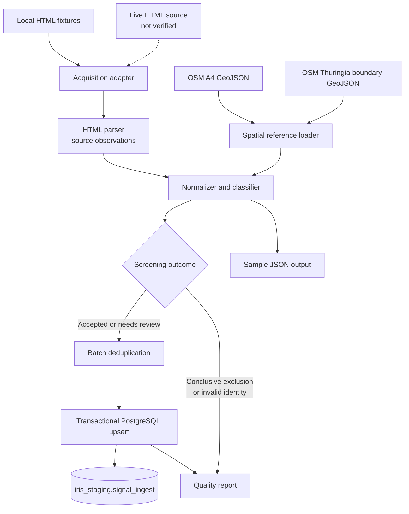
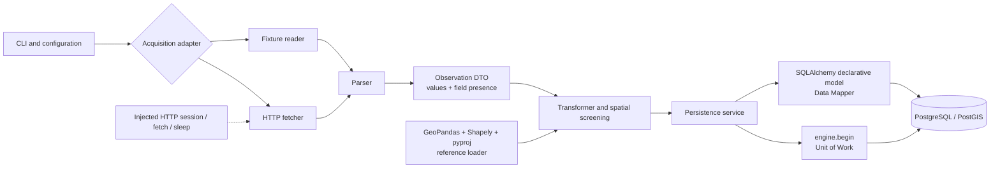
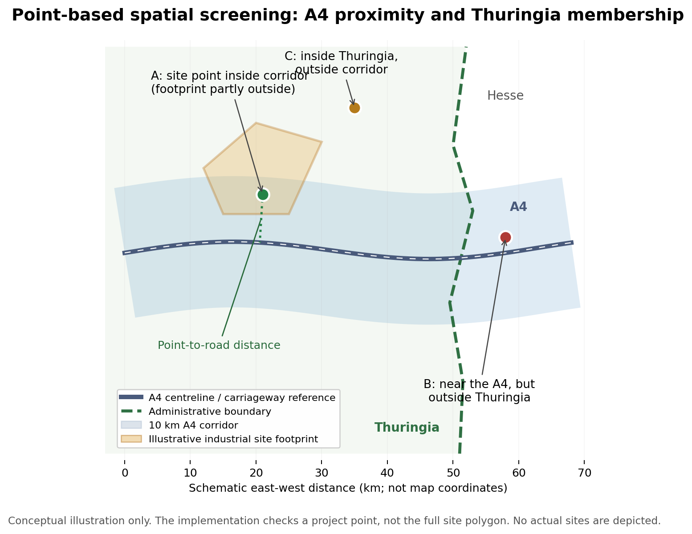
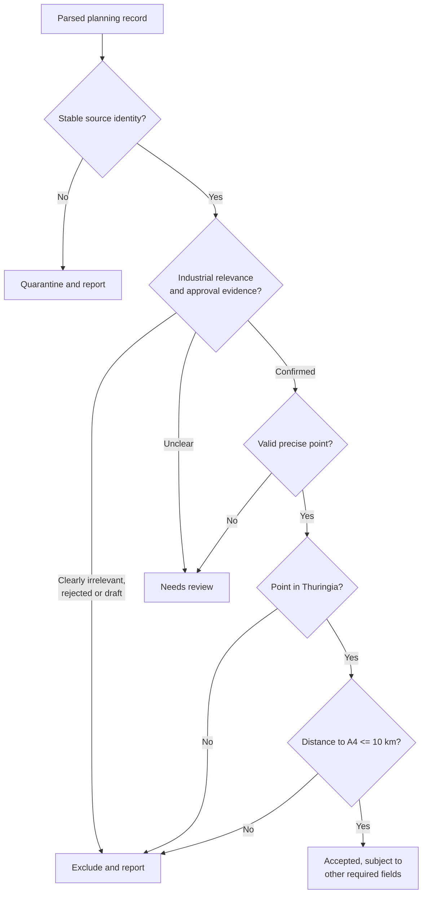
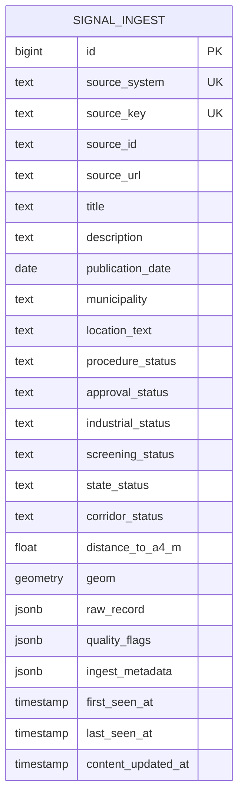
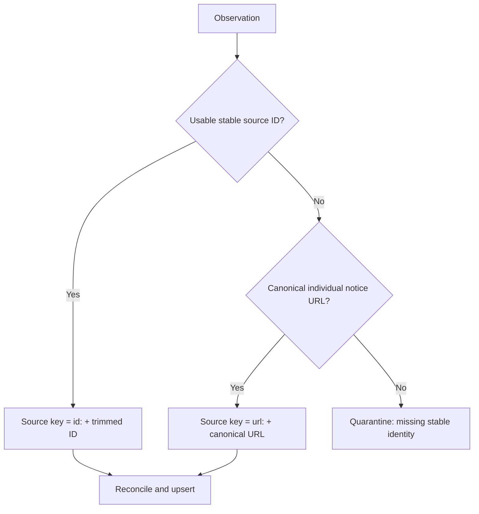
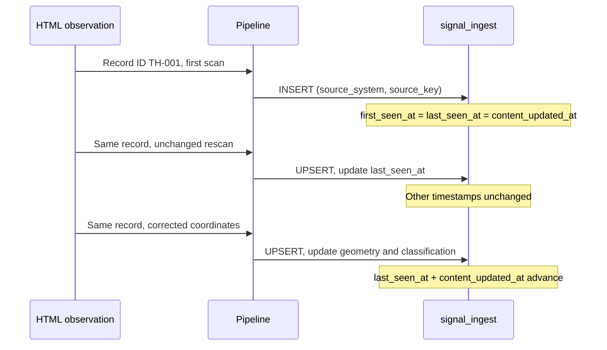
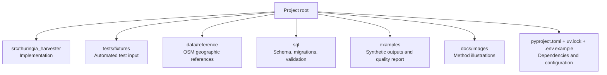

# Thuringia Planning Harvester

**A reproducible Python/PostGIS prototype for identifying industrial planning and approval signals near the A4 motorway in Thuringia, Germany.**

Built as a focused **10-hour engineering task** on an Apple Silicon Mac, using PyCharm, Codex, ChatGPT, Python 3.12, and a native local PostgreSQL/PostGIS installation. The result is a working **fixture-tested prototype**, not a validated live-portal connector or a production-ready approval register.

| Prototype at a glance | Implementation |
| --- | --- |
| Primary objective | Identify potentially relevant industrial approvals within Thuringia and within a configurable distance of the A4 |
| Data acquisition | HTML source adapter with separate local-fixture and live-HTTP modes |
| Spatial references | Real OpenStreetMap A4 road geometry and Thuringia administrative boundary |
| Spatial calculation | **Project centre point**; distance to A4 and point-in-state test in EPSG:25832 |
| Default corridor | **10 km** from the motorway, inclusive; an explicit prototype assumption |
| Destination | PostgreSQL 16 / PostGIS 3.4, `iris_staging.signal_ingest` |
| Demonstrated execution | Synthetic fixtures, automated unit tests, and local PostGIS integration tests |
| Source limitation | The target portal was unavailable; live HTML structure and pagination remain unverified |
| Development effort | **10 focused hours** |

> **Interpretation boundary:** A qualifying record has a *point* inside the A4 corridor and the Thuringia boundary. This does **not** establish that the complete industrial site footprint lies within the corridor. A site's shape, area, or intersection with the corridor is **not** evaluated by this prototype.

## Quick start (no database required)

With Python 3.12 and `uv` installed, from the repository root:

```sh
uv sync --locked
uv run thuringia-harvester --dry-run
uv run pytest -ra
```

The dry run parses the default **synthetic** HTML fixture, validates the real geographic references, and produces a report **without connecting to PostgreSQL**. For database-backed execution and first-time Mac setup, see [Mac setup](#mac-setup-and-development-tools), [configuration](#configuration-and-environment-files), and [running the harvester](#running-the-harvester).

## Contents

1. [What this prototype does](#what-this-prototype-does)
2. [System architecture and ETL workflow](#system-architecture-and-etl-workflow)
3. [Geographic method and spatial limitations](#geographic-method-and-spatial-limitations)
4. [Data model and database design](#data-model-and-database-design)
5. [Record identity, reconciliation, and rescans](#record-identity-reconciliation-and-rescans)
6. [Filtering, missing values, and quality reporting](#filtering-missing-values-and-quality-reporting)
7. [Project structure](#project-structure)
8. [Mac setup and development tools](#mac-setup-and-development-tools)
9. [Configuration and environment files](#configuration-and-environment-files)
10. [Running the harvester](#running-the-harvester)
11. [Running the tests and validating the database](#running-the-tests-and-validating-the-database)
12. [Efficiency and implementation choices](#efficiency-and-implementation-choices)
13. [Verification status and limitations](#verification-status-and-limitations)
14. [Future improvements](#future-improvements)
15. [Reference data and attribution](#reference-data-and-attribution)

---

## What this prototype does

The defined engineering task is to extract planning and approval notices from `https://thueringen.de/bauleitplanung` (HTML integration), identify industrial-site signals, assess their location relative to the **A4 motorway** and **Thuringia's state boundary**, and persist traceable results in PostGIS.

The original portal could not be accessed during development. Consequently, the pipeline was demonstrated using **two deliberately constructed HTML fixtures**, not actual notices from the portal. The fixture HTML is representative test material; its selectors, projects, dates, coordinates, and `.invalid` links must not be presented as observed source data.

The two geographic reference datasets, unlike the notices, contain **real OpenStreetMap geometries**. They provide an independent basis for geographic calculations, but do not establish that any synthetic industrial project is real.

**Implemented scope**

- Acquire local fixture HTML or use a separately configurable HTTP acquisition adapter.
- Extract source records, retaining original source-field values and which fields were explicitly present.
- Normalize dates, source identity, industrial relevance, approval evidence, coordinates, and quality flags.
- Check both **Thuringia membership** and **A4 distance** for valid project points.
- Insert/update records with stable identities and a transactional, idempotent PostgreSQL upsert.
- Generate sample output, validation queries, and a quality report that accounts for exclusions, ambiguous records, and parsing errors.
- Test parsing, transformations, mocked HTTP behavior, geometry, and database operations without depending on the inaccessible portal.

**Not demonstrated:** successful retrieval or parsing of the real portal; actual pagination selectors; the correctness of real-source publication dates or planning-status semantics; end-to-end ingestion of real approvals.

## System architecture and ETL workflow

### End-to-end ETL



The pipeline is coordinated by a small command-line interface. Acquisition, parsing, transformation, and persistence are separate so each can be tested without exercising every other component.

### Component architecture and design patterns



The main architectural choices are deliberately modest:

| Choice | Why it is used |
| --- | --- |
| **Layered ETL** | Keeps acquisition, parsing, transformation, and persistence independently understandable and testable. |
| **Dependency injection** | HTTP session, fetch function, and retry sleep function can be substituted for deterministic network tests. |
| **Adapter-style acquisition** | Fixture input and HTTP input feed the same downstream pipeline; no duplicate business logic. |
| **Observation data transfer object** | A dataclass carries values, explicit field presence, and observation flags across stages. |
| **SQLAlchemy Data Mapper** | The declarative `SignalIngest` model maps Python fields onto the staging table. |
| **Unit of Work** | `engine.begin()` owns a complete persistence batch: commit together or roll back on failure. |

These patterns are used where they add clarity; the prototype does not introduce a large framework, a UI, or unnecessary abstraction layers.

## Geographic method and spatial limitations

### Two independent geographic conditions

The geographic reference comprises:

| Dataset | Purpose |
| --- | --- |
| [`data/reference/a4_thueringen.geojson`](data/reference/a4_thueringen.geojson) | A4 motorway lines; includes the relevant section through neighboring Hessen so proximity remains continuous. |
| [`data/reference/thueringen_boundary.geojson`](data/reference/thueringen_boundary.geojson) | Thuringia administrative MultiPolygon; determines whether the project point is located in the target state. |

For a point with validated, sufficiently precise coordinates:

```text
state_status    = inside, if Thuringia polygon covers the point
corridor_status = inside, if distance(point, A4 lines) <= A4_BUFFER_METERS
spatial_match   = both statuses are inside
```

The configured default is `A4_BUFFER_METERS=10000` (10 km). This is an **analytical assumption**, not a corridor width specified by the source. The exact boundary and the exact distance threshold are inclusive. All distance calculations use projected **EPSG:25832** coordinates, not angular longitude/latitude degrees.

The mathematical study region is:

`Thuringia boundary ∩ buffer(A4 lines, 10 km)`

The implementation evaluates the two conditions directly for each point; it does **not** construct a full corridor buffer for every record.

### Spatial example: centre points, not site footprints



*Conceptual illustration; not a real map or real industrial sites. A and C are in the illustrative state, B is outside. The road geometry is illustrative. The actual pipeline uses the supplied OSM references.*

- **Site A:** Its project **centre point** is within 10 km of the A4 and inside Thuringia. It passes the *spatial* test even though the illustrated industrial site polygon extends **beyond the corridor**.
- **Site B:** Its point is near the A4 but in Hessen. It fails the *state* test.
- **Site C:** Its point is inside Thuringia but farther than 10 km from the A4. It fails the *corridor* test.
- **No usable coordinates:** Both geographic classifications are `unknown`; the application does not invent a point from a municipality name.

**Important:** The unit of spatial evaluation is a point (source-provided or reliably resolved project centre), not a parcel or full industrial-site polygon. Therefore, the result says nothing about whether *all, most, or any specific percentage* of an industrial site's area is within the corridor. Accurate footprint screening would require polygon geometries and additional intersection/area calculations.

### Why the A4 geometry includes part of Hessen

An initial Thüringen-only OSM extraction omitted approximately 6.6 km of the A4 near **Wommen and Herleshausen**, where the motorway runs through Hessen. The road reference must include that segment to preserve a continuous distance reference; a *separate* administrative polygon excludes non-Thuringian projects.

The supplied reference files were reported as locally validated with:

- **A4:** 1,245 valid line features; two carriageway chains; approximately 382.872 km total line geometry; the earlier longitudinal gap resolved.
- **Thuringia:** one valid MultiPolygon, approximately 16,198.113 km² in EPSG:25832; two extra point members ignored with warnings.

Reference validation checks geometry type and validity, CRS, finite coordinates, reasonable regional extent, road connectivity and gaps, and plausible state geometry. Separate motorway carriageways are not forcibly joined. The geometry-connectivity tolerance (1 km) is **not** the study corridor width (10 km). These checks support reproducibility but do not independently certify OSM completeness or cadastral accuracy.

### Screening decision flow



## Data model and database design

The destination is a **single staging table**: `iris_staging.signal_ingest`. The database schema (`iris_staging`) is a namespace; the table (`signal_ingest`) stores normalized observations. `sql/init.sql` is the authoritative schema definition, including unique constraints, spatial checks, and a GiST index.

### Logical database structure



*Logical overview of important fields, not a generated SQL schema dump. `UNIQUE(source_system, source_key)` is a **composite** uniqueness constraint; the diagram labels both parts as UK for readability. Consult `sql/init.sql` and the SQLAlchemy model for precise column names, types, defaults, nullability, and additional fields (including quality and procedure attributes).*

| Field group | Examples | Treatment |
| --- | --- | --- |
| **Identity and provenance** | `id`, `source_system`, `source_key`, `source_id`, `source_url` | Stable row identity and source traceability. |
| **Source content** | `title`, description, `publication_date`, `municipality`, `location_text`, source procedure status | Missing values may remain `NULL`; they are not fabricated. |
| **Classifications** | `approval_status`, `industrial_status`, `state_status`, `corridor_status`, `screening_status` | Derived, reviewable decisions. |
| **Spatial fields** | `geom`, `distance_to_a4_m` | Point in EPSG:25832; nullable if location cannot be resolved. |
| **Original extracted fields** | `raw_record` (`JSONB`) | Direct source-field mapping rather than an HTML dump. |
| **Processing provenance** | `ingest_metadata` (`JSONB`) | Observation flags, A4 and boundary reference identifiers/hashes, corridor configuration. |
| **Lifecycle** | `first_seen_at`, `last_seen_at`, `content_updated_at` | Distinguish first observation, most recent observation, and changes to stored content. |

A synthetic record might preserve these *original extracted* attributes:

```json
{
  "id": "TH-001",
  "titel": "Genehmigung Industrieanlage Gotha",
  "datum": "15.10.2026",
  "gemeinde": "Gotha",
  "verfahrensstand": "Genehmigung erteilt"
}
```

This is an **illustrative** `raw_record`, not a real portal record or necessarily the literal field names of the committed fixtures. Derived statuses, distances, source-reference hashes, and fixture metadata belong outside `raw_record`.

### Fixture and real-source database separation

| Execution mode | `source_system` | Database |
| --- | --- | --- |
| Fixture | `thueringen_planning_fixture` | `TEST_DATABASE_URL`; separate `_test` or `_fixture` database |
| Live | `thueringen_planning` | `DATABASE_URL`; explicitly provisioned database |

This separation prevents synthetic records from being mistaken for public records. `raw_record` is not polluted with a redundant `synthetic` flag. Sample exports and quality reports explicitly identify fixture mode (for example, `source_mode=fixture`). Fixture records can be queried or removed by source namespace, but database separation is preferred. **No automatic deletion occurs when switching modes.**

## Record identity, reconciliation, and rescans

### Why `(source_system, source_key)`?

Different providers may use overlapping announcement IDs. A source-qualified stable key avoids cross-source collisions while remaining stable across rescans:

```sql
UNIQUE (source_system, source_key)
```

The key policy is deterministic:



- Preserve the source ID's case and punctuation; trim only surrounding whitespace.
- Canonicalize individual-item URLs consistently (normalize scheme and hostname; discard fragments; preserve meaningful query parameters).
- **Do not** identify records solely by title, municipality, coordinates, date, or their position in an HTML listing.
- Different official announcements about the same industrial site remain different records unless a stable source identity proves otherwise.
- If a URL-keyed record later gains a source ID, reconcile the uniquely matching URL and migrate its identity **without inserting a second row**. Ambiguous URL matches must not be merged.
- A record with no ID and no usable notice-specific URL is quarantined and accounted for in the quality report.

### What a rescan changes

| Scenario | Stored values | `first_seen_at` | `last_seen_at` | `content_updated_at` |
| --- | --- | --- | --- | --- |
| First sighting | Insert new row | Set | Set | Set |
| Identical, confidently identified rescan | Unchanged | Preserve | **Advance** | Preserve |
| Source changes a field or coordinates | Merge explicit changes; reclassify | Preserve | **Advance** | **Advance** |
| Field simply absent in later HTML | Keep known value; record omission as appropriate | Preserve | Advance if confidently observed | Change only if persisted content changes |
| Source explicitly clears/corrects a field | Retain the existing record and source identity; update or invalidate the affected current value and recalculate its classification. Do not delete the record. | Preserve | Advance | Advance |
| Failed or empty acquisition | No implicit deletions or timestamp refresh | Preserve | Preserve | Preserve |
| Updated A4/boundary used during a **new scan** | Recompute geography and stored reference provenance | Preserve | Advance for actually re-observed records | Advance if stored derived content changes |

One nuance matters: **an updated geographic reference is not a new observation of a source page.** The supplied baseline implementation recalculates geography during ingestion; it does **not** yet provide a separate reference-only reclassification command for all stored rows. That independent operation is listed under future improvements.



Records in the same batch are deduplicated using dictionary lookups: the last *explicit* value wins, while omitted values do not erase already observed data. The same distinction between omission and explicit clearing applies when merging against stored `raw_record`. Older replay timestamps must not overwrite newer content or move audit timestamps backward.

For database consistency, a batch uses one transaction, a shared advisory lock for prototype reconciliation, and a conflict-safe bulk upsert. Other writers must respect the same lock for equivalent serialization guarantees.

## Filtering, missing values, and quality reporting

### Field and status decisions

| Situation | Expected action |
| --- | --- |
| Verified industrial approval, valid point in Thuringia and within 10 km | `accepted` if other required fields are valid. |
| Possibly relevant, but exact location or approval evidence unavailable | `needs_review`, provided identity is stable. |
| Municipality known, no precise point | Geometry/distance `NULL`; geographic statuses `unknown`; no municipality centroid substitution. |
| Missing or invalid publication date; missing title | Keep traceable potentially relevant record for review; add flags. |
| Residential/retail plan, draft, consultation, rejection, or revocation | Exclude from new ingestion; explain in quality report. |
| Outside Thuringia or beyond corridor | Exclude from new ingestion; explain in quality report. |
| Missing reliable ID and record-specific URL | Quarantine; cannot safely upsert. |
| Ambiguous identity collision | Do not merge blindly; preserve auditable warning. |

For the fixture parser, `Genehmigung erteilt`, `Baugenehmigung erteilt`, and `Zulassung erteilt` are treated as approved **by a prototype rule**, not a verified legal interpretation of every German planning procedure. `Satzungsbeschluss`, `Inkrafttreten`, and plan adoption do not necessarily equal a building permit and remain review cases. The live portal's terminology must be examined before enabling real-source classification.

**Documented behavior for previously stored records:** The implementation retains a previously stored row that becomes conclusively ineligible as `needs_review` with `excluded_*` flags and counted as excluded in the report; it is not an active review item. New conclusively excluded records are not inserted. This preserves history, but downstream consumers must use the documented flags/report criteria rather than treating every `needs_review` row as an active review item. A distinct stored `excluded` status is a possible future simplification, not something this README claims is already implemented.

### Coordinate policy

The pipeline accepts explicitly identified coordinate systems EPSG:4326 or EPSG:25832, validates numeric/finite/plausible values, and transforms as needed using `always_xy=True`. Swapped axes are **rejected rather than guessed**. Invalid coordinates do not silently become `(0,0)`. Unresolved points produce `NULL` geometry and `unknown` geographic status.

### Quality reporting and evidence

The report accounts for input cards, identifiable observations, duplicate collapses, quarantine, industrial/approval decisions, geography, missing fields, and committed database changes. These categories can overlap, so do not add all warning/status counts together as though they were mutually exclusive.

For the **basic synthetic fixture**, the recorded validation run reports:

| Measure | Count |
| --- | ---: |
| HTML cards | 8 |
| Unique identities after deduplication | 7 |
| Accepted scenarios | 2 |
| Needs-review scenarios | 2 |
| Excluded scenarios | 3 |
| Database writes in dry-run mode | 0 |

On an empty dedicated test table, the fixture-backed database run inserts **four** rows (two accepted, two review). Repeating the same scan retains **four** rows rather than duplicating them; observation timestamps refresh where appropriate.

Reports and exports are deliberately labeled **synthetic**. The report files are generated outputs, not evidence that the corresponding approvals exist in Thüringen.

## Project structure

The repository follows a small `src`-layout Python package. This is an explanatory view of its principal components, not a claim that all possible files are shown.

```text
thuringia-planning-harvester/
├── src/
│   └── thuringia_harvester/
│       ├── cli.py                 # Pipeline command-line entry point
│       ├── config.py              # Environment and defaults
│       ├── fetcher.py             # HTML acquisition
│       ├── parser.py              # HTML to observations
│       ├── transform.py           # Business and spatial decisions
│       ├── models.py              # Records / ORM mapping
│       └── database.py            # Connection, reconciliation, upserts
├── data/
│   └── reference/
│       ├── a4_thueringen.geojson
│       ├── thueringen_boundary.geojson
│       └── README.md              # Data provenance
├── tests/
│   └── fixtures/
│       ├── planning_basic.html
│       └── planning_edge_cases.html
├── sql/
│   ├── init.sql
│   ├── migrate_state.sql
│   ├── migrate_raw_record.sql
│   └── validation.sql
├── examples/
│   ├── sample_output.json
│   └── quality_report.json
├── docs/
│   └── images/
│       └── spatial-screening.png
├── AGENTS.md
├── pyproject.toml
├── uv.lock
├── .env.example              # Sample env file; sometimes called .env.sample
├── .env                      # Local secrets/settings; not committed
└── README.md
```

### Responsibilities by directory



The design favors clear file responsibilities over reproducing the many layers of a larger BI application.

## Mac setup and development tools

This prototype was developed on a **MacBook Air with Apple M2 (Apple Silicon)**. The toolchain runs natively on macOS, without Docker or emulation.

| Tool | Purpose | Installation / setup |
| --- | --- | --- |
| **Git** | Version control | Install Apple Command Line Tools (`xcode-select --install`) or Git via [Homebrew](https://brew.sh/). Optional traditional GUIs: `brew install git git-gui` (includes `gitk`). |
| **PyCharm** | Python IDE | Download the **Apple Silicon** build from [JetBrains](https://www.jetbrains.com/pycharm/download/). Open the repository root as a project. |
| **Codex** | In-IDE coding assistance | In PyCharm, install/enable JetBrains **AI Assistant**, select **Codex** in AI Chat, and authenticate using the supported ChatGPT account flow. [JetBrains guide](https://www.jetbrains.com/help/ai-assistant/codex-agent.html). |
| **ChatGPT** | Design and code-review assistance | Used for architecture, requirements clarification, and technical review; project guidance is retained in `AGENTS.md`. |
| **uv** | Python and dependencies | Install from [Astral](https://docs.astral.sh/uv/getting-started/installation/) using the official standalone installer, or through Homebrew. |
| **Python 3.12** | Runtime | Install with `uv python install 3.12` or use another native Python 3.12 interpreter. The project sets its version requirements in `pyproject.toml`. |
| **Postgres.app** | Native local database | Download the **PostgreSQL 16 + PostGIS 3.4** variant from [Postgres.app](https://postgresapp.com/downloads.html); move to `/Applications`, launch, and initialize a server. |

These tools support an AI-assisted development workflow, but the reproducible application and tests do **not** require ChatGPT or Codex to be present at runtime.

### Terminal setup

From the project directory:

```sh
# Install uv if it is not installed already.
curl -LsSf https://astral.sh/uv/install.sh | sh

# Install Python 3.12 using uv if needed.
uv python install 3.12

# Create/synchronize the virtual environment from the lock file.
uv sync --locked

# Check the application command.
uv run thuringia-harvester --help
```

In PyCharm, select the repository's `.venv/bin/python` interpreter. On a configured local Postgres.app installation, expose the PostgreSQL 16 command-line tools in your terminal session:

```sh
export PATH="/Applications/Postgres.app/Contents/Versions/16/bin:$PATH"
psql --version
```

If `uv` was installed inside `.venv/bin` in an existing environment rather than as a user-level command, add that directory to `PATH` before running the commands. A fresh installation should prefer the standard standalone installer.

### Local PostGIS verification

Start the PostgreSQL 16 server from Postgres.app. Confirm that the extension is available in the database you intend to use:

```sh
psql -d postgres -c 'SELECT version();'
```

After the test database has been created, you can also check:

```sh
psql -d thuringia_harvester_test -c 'SELECT PostGIS_Version();'
```

The prototype's configured fixture database setup enables PostGIS and initializes the required schema/table when permissions allow. You do not need Docker or pgAdmin.

## Configuration and environment files

The committed sample environment file is **`.env.example`** (equivalent in purpose to a file commonly named `.env.sample`). Create your private configuration by copying it:

```sh
cp .env.example .env
```

`.env` must be excluded from Git because it can contain connection credentials. `pydantic-settings` reads environment variables and the root `.env`; CLI arguments override the relevant input-path and mode options as documented below.

### Important settings

| Setting | Role | Prototype behavior |
| --- | --- | --- |
| `FIXTURE_MODE` | **Fixture flag**; switches between synthetic HTML and live HTTP | `true` by default. `false` uses `SOURCE_URL`; fixture arguments are ignored with a notice. |
| `FIXTURE_PATHS` | Default local fixture input(s) | Basic HTML fixture by default; `--fixture` overrides in fixture mode. Follow the file's example syntax for multiple paths. |
| `FIXTURE_BASE_URL` | Base for relative links inside synthetic HTML | Used to resolve links, not requested over HTTP in fixture mode. |
| `SOURCE_URL` | Target portal URL | Used only with `FIXTURE_MODE=false` / `--live`. Its compatibility remains unverified. |
| `TEST_DATABASE_URL` | Dedicated fixture/test PostgreSQL connection | **Required for fixture writes**; no silent fallback to live database. |
| `DATABASE_URL` | Separate live-source PostgreSQL connection | Used only in live mode; database is not automatically provisioned. |
| `A4_BUFFER_METERS` | Inclusive corridor distance | Default `10000` (metres). |

Example **illustrative** `.env` values (check the repository's `.env.example` for the complete current set of supported keys and exact multi-path syntax):

```dotenv
FIXTURE_MODE=true
SOURCE_URL=https://thueringen.de/bauleitplanung
TEST_DATABASE_URL=postgresql+psycopg://YOUR_ROLE@localhost:5432/thuringia_harvester_test
DATABASE_URL=postgresql+psycopg://YOUR_ROLE@localhost:5432/thuringia_harvester
A4_BUFFER_METERS=10000
```

Replace `YOUR_ROLE` with your local PostgreSQL role, and provide any required password securely. The `SOURCE_URL` value is the originally intended source, **not a verified working endpoint**. Do not commit a populated `.env` file.

### Switching off the fixture flag

Setting `FIXTURE_MODE=false` (or passing `--live`) selects the HTTP acquisition adapter. This makes it possible to adapt the same pipeline to real HTML later. It **does not** make the current parser production-ready. Before live operation, verify lawful access, inspect the actual DOM, adapt selectors and links, establish pagination rules, validate source status/date interpretation, and test the live path with representative captured source pages. No fixture fallback occurs after a live request fails.

## Running the harvester

Run the following commands from the repository root after `uv sync --locked`. Full current CLI option syntax is available from:

```sh
uv run thuringia-harvester --help
```

### Command examples

**1. Offline dry run with the default basic fixture** (does not connect to a database):

```sh
uv run thuringia-harvester --dry-run
```

**2. Deterministic demonstration with explicit output paths:**

```sh
uv run thuringia-harvester \
  --fixture tests/fixtures/planning_basic.html \
  --dry-run \
  --scan-time 2026-10-27T12:00:00+00:00 \
  --output examples/sample_output.json \
  --quality-report examples/quality_report.json
```

**3. Expanded offline input:**

```sh
uv run thuringia-harvester \
  --fixture tests/fixtures/planning_basic.html \
  --fixture tests/fixtures/planning_edge_cases.html \
  --dry-run
```

**4. Persist fixture results in the dedicated test database** (`FIXTURE_MODE=true` and `TEST_DATABASE_URL` configured):

```sh
uv run thuringia-harvester \
  --fixture tests/fixtures/planning_basic.html
```

**5. Parser-only exploration** (without geographic-reference loading):

```sh
uv run thuringia-harvester \
  --fixture tests/fixtures/planning_edge_cases.html \
  --parser-only --dry-run
```

Parser-only records have **unknown geographic status** and cannot be accepted. This is intentionally a parsing diagnostic mode, not a valid spatial classification.

**6. Live acquisition interface** (not verified against the real source):

```sh
FIXTURE_MODE=false uv run thuringia-harvester --live --dry-run
```

A live request can fail because the source is inaccessible or the DOM format differs. Do not interpret the presence of this command as evidence of a successful real-source scan.

### CLI argument reference

| Option | Function / important behavior |
| --- | --- |
| `--fixture PATH` | Provide a local HTML page; repeat to include multiple pages. Active only in fixture mode. |
| `--dry-run` | Execute analysis and reporting **without** database initialization or writes; counters for writes remain zero. |
| `--live` | Select HTTP mode (`FIXTURE_MODE=false`); fixture arguments are ignored with a notice. |
| `--parser-only` | Skip geographic-reference loading; geography remains unknown, so no record qualifies as accepted. |
| `--allow-missing-a4` | Allow an **absent** A4 file while keeping proximity unknown; does not accept an invalid A4 file or remove the requirement for a valid state boundary. |
| `--a4-geojson PATH` | Override the road reference file for this invocation. |
| `--state-geojson PATH` | Override the Thuringia boundary file for this invocation. |
| `--scan-time ISO_TIMESTAMP` | Supply a controlled, timezone-aware scan timestamp, useful for deterministic demonstrations/tests; not a source publication date. |
| `--output PATH` | Write sample/exported JSON. |
| `--quality-report PATH` | Write processing/quality report JSON. |
| `--help` | Show the full CLI interface, including implementation-specific settings not enumerated here. |

Environment-based reference paths are interpreted relative to the repository root; explicit CLI file paths are interpreted relative to the invoking directory. Live HTTP uses GET, content-type checks, bounded retries/timeouts, and pagination safeguards (page limits and cycle detection) **in the tested generic acquisition layer**. Actual pagination links/selectors for the unavailable portal have **not** been verified or implemented against real HTML.

### Initializing a new local database

A fixture run with a configured `TEST_DATABASE_URL` can create a missing dedicated test database and initialize the extension/schema/table. The database name must end in `_test` or `_fixture`, must be distinct from the live database, and is checked against `current_database()` before writes. The role needs `CREATEDB` if the application is to provision it automatically.

If you prefer manual provisioning, for example:

```sh
createdb thuringia_harvester_test
psql -d thuringia_harvester_test -c 'CREATE EXTENSION IF NOT EXISTS postgis;'
psql -v ON_ERROR_STOP=1 -d thuringia_harvester_test -f sql/init.sql
```

A **separate real-source database** may also be created and initialized manually, for future use:

```sh
createdb thuringia_harvester
psql -d thuringia_harvester -c 'CREATE EXTENSION IF NOT EXISTS postgis;'
psql -v ON_ERROR_STOP=1 -d thuringia_harvester -f sql/init.sql
```

Its URL belongs in `DATABASE_URL`, not `TEST_DATABASE_URL`. The application will **not** automatically create a live database, and real-source ingestion is not verified.

For an existing prototype database that predates the documented schema changes, the supplied SQL migrations are idempotent and can be applied explicitly:

```sh
psql -v ON_ERROR_STOP=1 -d thuringia_harvester_test -f sql/migrate_state.sql
psql -v ON_ERROR_STOP=1 -d thuringia_harvester_test -f sql/migrate_raw_record.sql
```

**Do not run migrations against another database without checking its schema and taking a backup.**

## Running the tests and validating the database

### Automated tests and code quality

```sh
uv run pytest -ra
uv run ruff check src tests
uv run ruff format --check src tests
```

The latest documented verification run reports:

| Verification | Reported outcome |
| --- | --- |
| Automated test suite | **115 passed** |
| Strict expected-failure tests (`xfail`) | **2** — explicitly deferred behavior, not passing acceptance tests |
| Database integration | Executed against **native local PostgreSQL 16 / PostGIS 3.4**, port 5432 |
| Actual portal / real notices | **Not tested** |
| Actual portal pagination | **Not verified** |
| Independent acceptance audit | **Not performed** |

These are **recorded results**, not a guarantee that a later checkout has identical counts. Re-run the commands above for the current codebase. Database integration tests are configured to **skip explicitly** when no test URL is configured, but a configured broken connection causes a failure.

The tests were **not developed as a complete test-driven development (TDD) process**, and the final code has **not** undergone an independent acceptance or security audit. Passing automated tests demonstrates behavior within the modeled fixtures, mocks, reference datasets, and local database setup; it is not proof that arbitrary real portal pages are supported.

The two documented expected-failure tests relate to: (1) a different policy for removing previously stored conclusively excluded rows, and (2) independently recalculating reference-only changes without advancing `last_seen_at`. The first is also a **policy decision** and should be reconciled with the selected retention behavior before being treated as a required future change. Both are documented as limitations, not silent successes.

### Local database validation

Run a fixture-backed database scan twice, then execute the repository's SQL validations:

```sh
uv run thuringia-harvester --fixture tests/fixtures/planning_basic.html
uv run thuringia-harvester --fixture tests/fixtures/planning_basic.html
psql -v ON_ERROR_STOP=1 -d thuringia_harvester_test -f sql/validation.sql
```

The baseline demonstration expects four retained rows after the second scan of the basic fixture. Useful manual checks include:

```sql
SELECT source_system, source_key, screening_status,
       first_seen_at, last_seen_at, content_updated_at
FROM iris_staging.signal_ingest
ORDER BY source_system, source_key;

SELECT source_system, source_key, ST_SRID(geom) AS srid,
       distance_to_a4_m, state_status, corridor_status
FROM iris_staging.signal_ingest
WHERE geom IS NOT NULL;

SELECT source_system, source_key, COUNT(*)
FROM iris_staging.signal_ingest
GROUP BY source_system, source_key
HAVING COUNT(*) > 1;
```

The final duplicate query should return **no rows**. The repository's `sql/validation.sql` also checks its declared constraints and timestamp assumptions. A failed batch must roll back rather than leave partially committed records.

## Efficiency and implementation choices

The first version emphasizes **clear boundaries, deterministic behavior, and reasonable performance**, not distributed-scale ingestion.

| Implemented measure | Benefit |
| --- | --- |
| **Load/validate/dissolve/reproject each geographic reference once per run** | Avoid repeated GeoJSON parsing, CRS conversion, and geometry union per observation. |
| **Reuse pyproj transformers** | Avoid repeated transformer setup and preserve consistent axis-order handling. |
| **Reuse one HTTP session** | Share connections/configuration across requests and permit dependency-injected mock sessions. |
| **Dictionary-based in-batch deduplication and lookup** | Avoid quadratic scans for ordinary duplicates within the incoming batch. |
| **One bulk PostgreSQL upsert within one transaction** | Reduce round trips and ensure batch atomicity instead of individual per-row commits. |
| **Direct point-to-motorway distance calculation** | Avoid constructing or testing a separate buffer polygon for every incoming record. |
| **Defer writes until acquisition validation** | Incomplete/failed pagination does not silently become a partial successful ingestion. |

These decisions keep the prototype efficient for small and moderate fixture batches while remaining straightforward to understand and test.

## Verification status and limitations

| Area | Supported evidence | Still unverified or limited |
| --- | --- | --- |
| HTML parsing | Basic and 32-case extended synthetic fixtures | Real DOM, selectors, field interpretation |
| Network behavior | Mocked GET failures, retries, authorization/status handling, pagination safeguards | Real endpoint access and actual page navigation/pagination |
| Spatial filtering | Real OSM reference files and geometry validation; simulated project points | Accuracy of any real project's location or full site footprint |
| Database | Local PostGIS integration, uniqueness, transactions, rescans | Production deployment and operational load |
| Test quality | Automated unit/integration testing | No formal TDD lifecycle; no independent acceptance/security audit |
| Domain semantics | Explicit fixture-based heuristics | Real German planning/approval semantics and publication dates |

In particular, **a change from fixture mode to live mode is a development starting point, not a switch that instantly enables verified production harvesting.** The inaccessible source and lack of real portal pagination are central limits of this first prototype.

## Future improvements

### Performance and scalability

The current implementation retains a few **known, avoidable inefficiencies** that are reasonable for a 10-hour prototype:

1. **Identity reconciliation can be quadratic.** Existing ID/URL searches occur inside the incoming-record loop. With `M` incoming and `N` stored records, reconciliation can approach **O(MN + M²)**. Build source-ID and canonical-URL lookup dictionaries once, or perform indexed database lookups.
2. **The full source namespace is loaded.** This simplifies reconciliation now, but will become expensive as the table grows. Fetch only identities that can plausibly match incoming records, using indexed SQL queries.
3. **Deduplication happens twice.** The CLI and persistence service both deduplicate. This protects the persistence API when called independently, but adds a redundant pass in normal execution. Consolidate responsibility without weakening the API contract.
4. **All source pages are kept in memory.** This allows validation of acquisition before writing, but constrains throughput. Introduce bounded page processing, checkpointing, and safe batch boundaries when scale justifies them.

### Functional and operational work

- **Live source integration:** Verify access permissions, inspect the real HTML, adapt selectors, and build/test actual pagination and publication-date extraction.
- **Approval-domain validation:** Revisit the exact legal meaning of planning stages and approved industrial developments with real source examples.
- **Geographic reference refresh:** Add a separate command to reclassify already stored records after a road/boundary update **without** changing `last_seen_at`; record derived-reference provenance independently from source observations.
- **Historical exclusions:** Revisit whether a distinct persistent `excluded` status or an append-only decision history would be clearer than the current retained-history flags.
- **Location quality:** Add explicit coordinate precision, reviewable geocoding of unambiguous addresses, and handling of source coordinate corrections.
- **Industrial-site polygons:** When reliable site footprints exist, compute polygon/corridor intersections, area shares, and cases where the site centre qualifies but the footprint does not lie entirely within the buffer.
- **Production hardening:** CI, periodic scheduled runs, independent test/acceptance review, provenance checks, security review, monitoring, and scalable reference/database caching.
- **Open data stewardship:** Retain reproducible exact download queries/timestamps, establish data refresh policy, and assess ODbL obligations for distributed derived datasets.

## Reference data and attribution

The reference datasets were extracted from **OpenStreetMap via Overpass Turbo**. `data/reference/README.md` is the authoritative project-local provenance note for any embedded metadata, extents, hashes, and validation details. The exact historical Overpass requests and download times were **not** retained in the supplied evidence and are not reconstructed here.

- [OpenStreetMap copyright and ODbL attribution](https://www.openstreetmap.org/copyright)
- [Overpass Turbo](https://overpass-turbo.eu/)
- [PostGIS documentation](https://postgis.net/documentation/)
- [GeoPandas](https://geopandas.org/), [Shapely](https://shapely.readthedocs.io/), and [pyproj](https://pyproj4.github.io/pyproj/)
- [SQLAlchemy](https://docs.sqlalchemy.org/) and [uv](https://docs.astral.sh/uv/)

**Data and software licensing are separate.** OpenStreetMap reference data requires proper attribution and may impose ODbL obligations on distribution of adapted or derived data; code licensing does not override that requirement.

---

**Summary:** This 10-hour, native-macOS engineering prototype demonstrates a modular, testable HTML-to-PostGIS ingestion pipeline with real OSM spatial references, stable identity/upsert semantics, explicit data-quality handling, and local integration testing. Its principal outstanding task is **validation and adaptation against the actual source portal**, followed by independent acceptance testing before production use.
